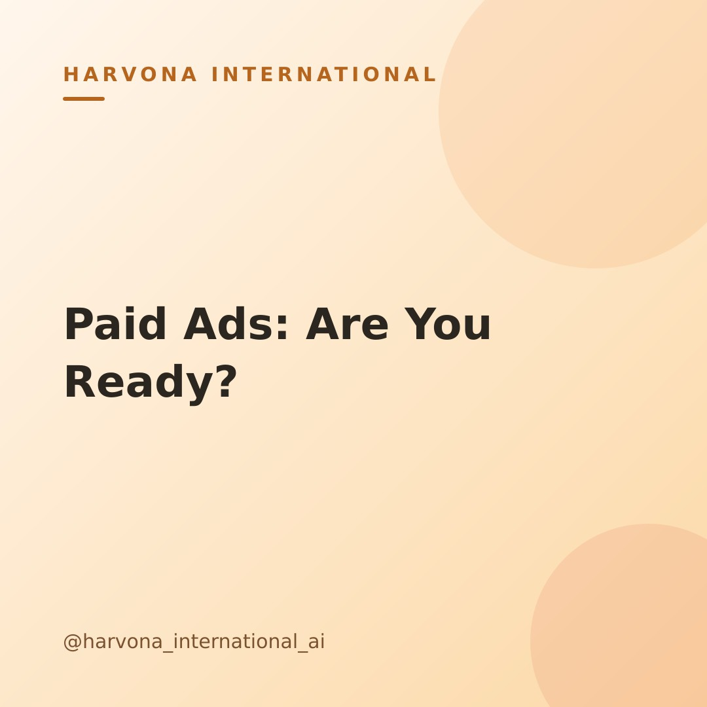

# Draft post — 2026-10-23-1748

**Topic:** Should you start running paid ads yet? A simple gut-check for founders

## Caption

Many founders wonder if it's time to invest in paid ads. It feels like a big step, right? Before diving in, there are a few simple signs your business should (or shouldn't) be seeing.

First, are you consistently getting organic sales and customer feedback? This shows your product/service resonates. Second, do you have a clear handle on what makes your current customers happy? Knowing this helps you craft ads that convert. If the answer is "yes" to these, you're building a strong foundation. Without them, ads can amplify a message that isn't quite ready yet, leading to wasted spend.

Paid ads can be a powerful growth engine for lean teams, especially with AI making them more accessible. But timing is key! 🔑 Where do you stand on these points? Share your thoughts below!

#paidadsstrategy #smallbizmarketing #founderjourney #digitalmarketingtips #growwithai #businesstips #marketingforfounders #paidadvertising #leanmarketing #marketingstrategy

---
_Merge this PR to approve and publish. Close it to reject._
