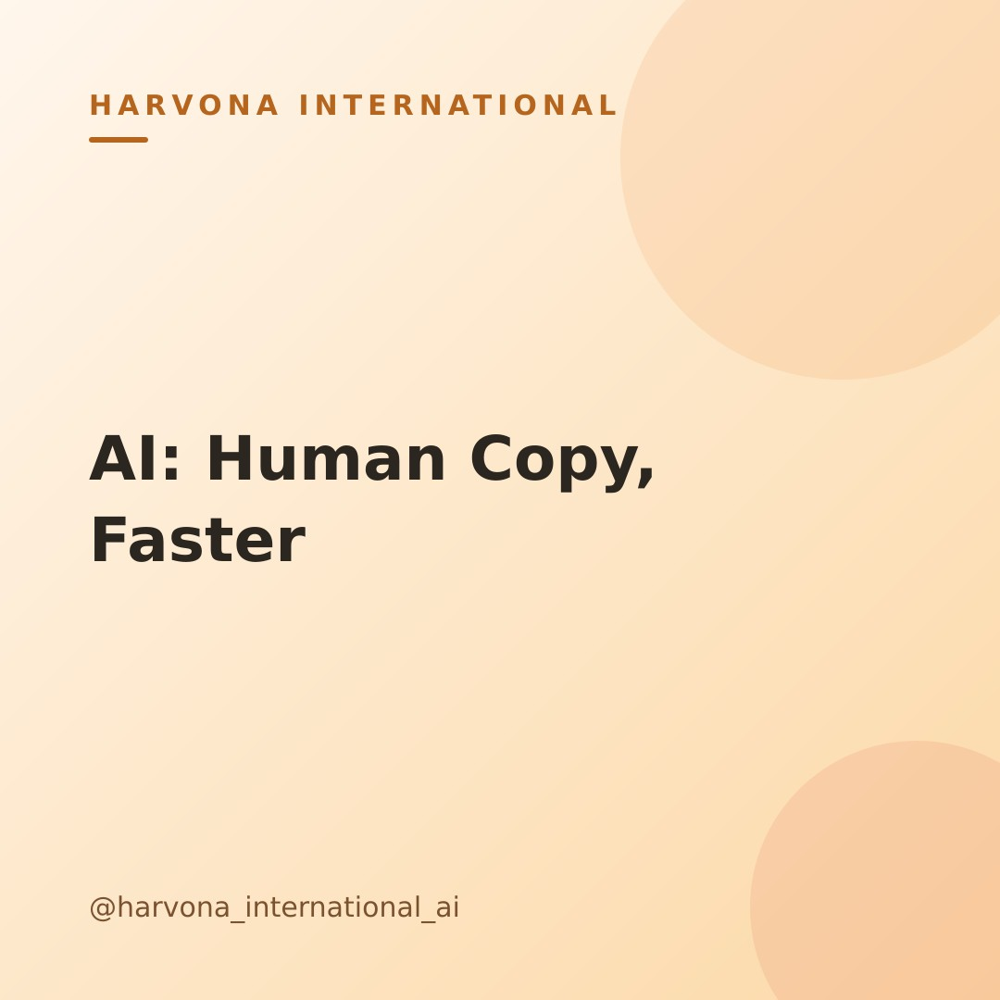

# Draft post — 2026-10-26-1906

**Topic:** How to write marketing copy faster with AI without it sounding robotic

## Caption

Ever feel like writing marketing copy takes forever, or worse, that your AI-generated drafts sound a little... robotic? It's a common challenge for busy founders balancing speed with authenticity.

The trick isn't letting AI write everything for you, but treating it like your smartest brainstorming partner ✍️. Give it specific instructions: your audience, your brand voice, and even examples of copy you love. Then, use its output as a *strong first draft*.

Your job? To infuse it with your unique personality, tweak it to sound genuinely *you*, and ensure it carries that human touch. It's about refining its ideas, not just accepting them wholesale. This hybrid approach means you save precious time on drafting, and your marketing messages always sound genuinely *you*. It's about leveraging AI's speed without losing your authentic voice. ✨

What's one piece of marketing copy you're excited to tackle with AI this week? Let us know!

#aimarketing #smallbusinessmarketing #contentcreation #marketingtips #aitools #founderlife #digitalmarketing #copywritingtips #aiforsmallbusiness #marketingstrategy #growyourbusiness #businesstips

---
_Merge this PR to approve and publish. Close it to reject._
