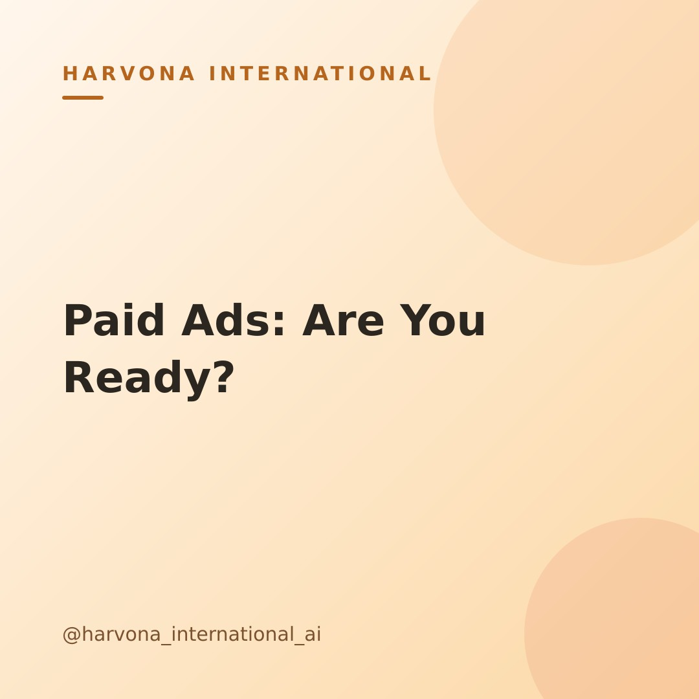

# Draft post — 2026-10-30-1830

**Topic:** Should you start running paid ads yet? A simple gut-check for founders

## Caption

Thinking about diving into paid ads but wondering if it's the right time? It's a common founder dilemma! You want to grow, but jumping in too soon can feel like throwing money into the wind.

Before you invest, ask yourself: Do you know who your ideal customer is? Is your core offer clear and converting organically, even if on a small scale? Do you have a simple way to track results? If you can confidently answer 'yes' to these, you're building a solid foundation. If not, focus there first. Paid ads amplify what you already have – good or bad!

No need to rush. Building a strong base first makes every ad dollar work harder and smarter. What's one thing you're focusing on before launching paid campaigns? 👇

#paidadsstrategy #smallbusinessmarketing #founderlife #digitalmarketingtips #growyourbusiness #marketingstrategy #adscampaign #startupadvice #smallbizowner #marketingforfounders #digitalgrowth #leanmarketing

---
_Merge this PR to approve and publish. Close it to reject._
