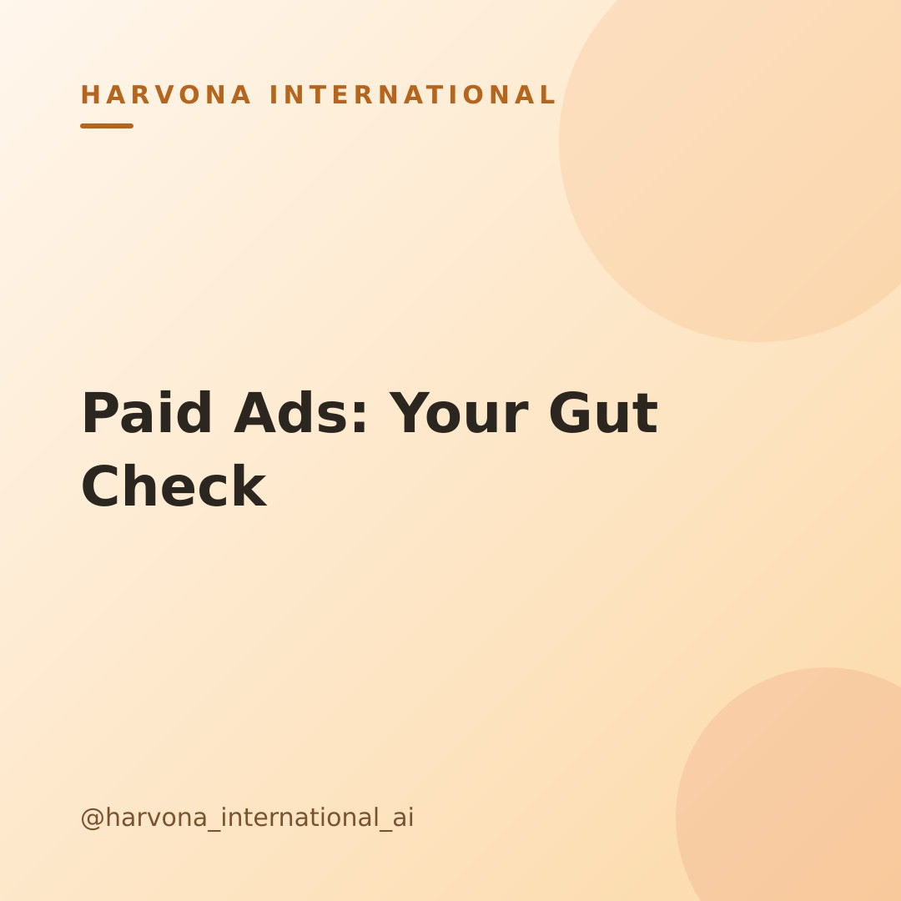

# Draft post — 2026-11-06-1954

**Topic:** Should you start running paid ads yet? A simple gut-check for founders

## Caption

Paid ads can feel like the fast lane to growth, right? It's tempting to jump in, expecting immediate leads and sales. But before you hit 'launch' on that first campaign, let's talk strategy.

A simple gut-check: Is your core offer clear, and does it already resonate with your audience organically, even on a small scale? Do you truly know *who* you're talking to and *what specific problem* you solve for them? Paid ads amplify what's already working. If your message isn't quite hitting home yet, ads will just amplify a message that isn't converting. 🤔

Focus on solidifying your foundation first. Ensure your product or service is truly needed, your messaging is crystal clear, and your organic efforts show at least a spark of engagement. Then, paid ads can be a powerful accelerator. Save this post if you're mapping out your next marketing move!

#paidads #digitalmarketing #smallbusinessgrowth #founderlife #marketingstrategy #aiforbusiness #leanstartup #adsgrowth #businesstips #marketingtips #onlinemarketing #growyourbusiness

---
_Merge this PR to approve and publish. Close it to reject._
