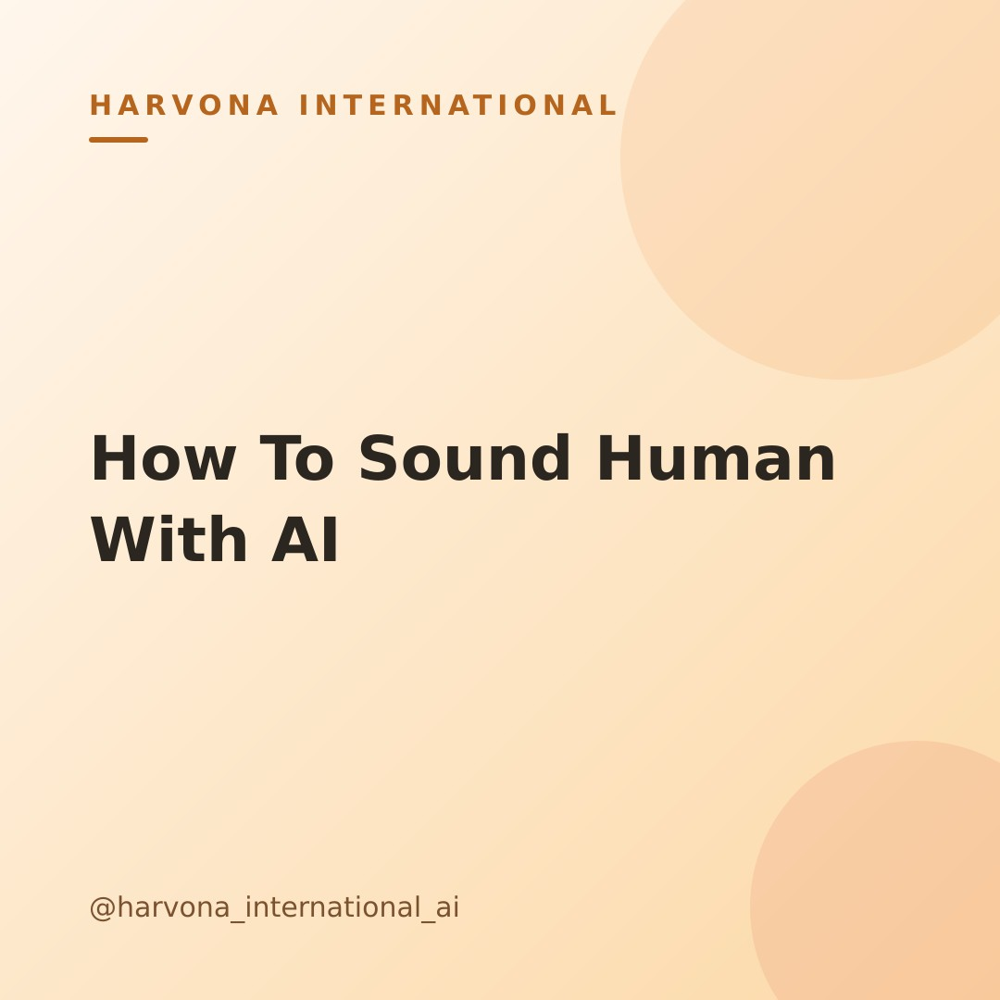

# Draft post — 2026-11-16-2248

**Topic:** How to write marketing copy faster with AI without it sounding robotic

## Caption

Ever feel like AI-generated copy misses that human touch? It's a common challenge. While AI can draft copy at lightning speed, sometimes it lacks your brand's unique voice and warmth. The secret isn't just *what* you ask, but *how* you guide it. Think of AI as your super-fast first draft assistant, not the final editor.

To make AI sound more like *you*, start with clear instructions. Give it examples of your previous successful copy, explain your brand's personality, and even tell it to "sound like a friendly expert" or "imagine explaining this to your best client." Then, always put on your editor's hat. Refine, add your personal anecdotes, and infuse it with genuine emotion. This step is crucial for authentic connection! ✨

Using AI this way frees up your time from staring at a blank page, so you can focus on polishing the message that truly resonates with your audience. It's about combining efficiency with authenticity. What's your favorite tip for making AI sound more like your brand? Let us know below!

#aimarketing #contentcreation #smallbizmarketing #digitalmarketingtips #aiforbusiness #copywritingtips #marketingstrategy #founderlife #businesstools #leanmarketing #aicoaching #marketingautomation

---
_Merge this PR to approve and publish. Close it to reject._
