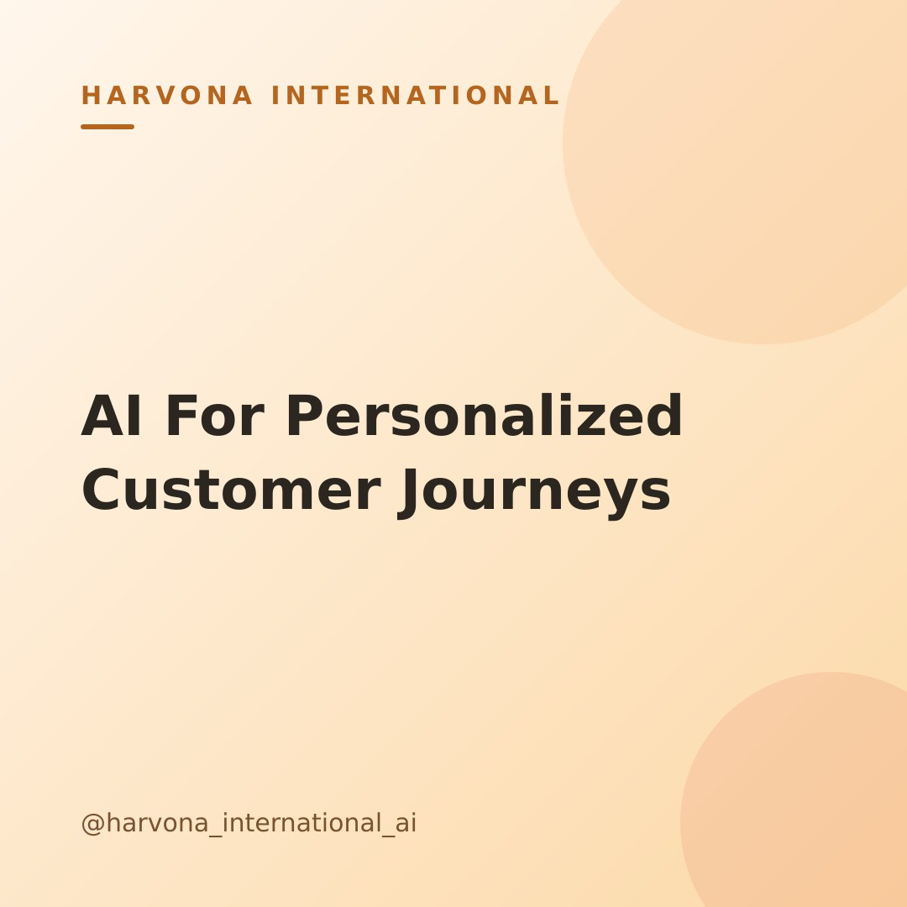

# Draft post — 2026-11-24-0040

**Topic:** How small businesses can personalize the customer experience using AI

## Caption

Ever wished you could connect with every customer like they're your only one? For small businesses, truly personalized experiences can feel out of reach – but AI is changing that game.

You don't need a huge team to make your marketing feel personal. AI tools can help analyze customer data, predict preferences, and even draft tailored messages. Think about automatically recommending products a customer actually *wants*, or sending follow-up emails that resonate deeply. ✨

It's about making your customers feel seen and understood, building loyalty one tailored interaction at a time. Ready to explore how AI can help you create those deeper connections? Save this post for inspiration!

#smallbusinessmarketing #aiforsmallbusiness #customerpersonalization #marketingstrategy #aiconsulting #digitalmarketing #smallbizowner #marketingtips #customerjourney #techforsmallbiz #businessgrowth #aipowered

---
_Merge this PR to approve and publish. Close it to reject._
