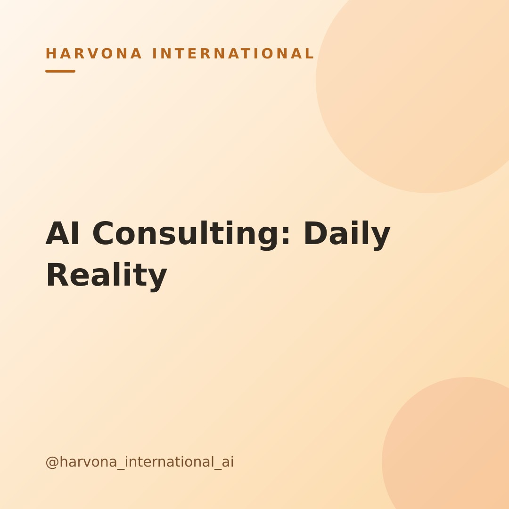

# Draft post — 2026-11-25-2217

**Topic:** What 'AI consulting' actually looks like day-to-day for a small business

## Caption

Ever wonder what 'AI consulting' actually *does* for a small business like yours? It’s not about complex algorithms or sci-fi tech! It’s really about practical, everyday improvements that free up your time and boost your marketing efforts.

Think of it as having an expert friend help you bake AI into your existing workflow. We might sit down to brainstorm how AI can instantly generate social media captions for your next product launch 

, or show you how to quickly analyze customer feedback to spot trends, saving hours of manual work. It's about finding those specific pain points where AI can be your extra team member.

The goal? To make modern marketing approachable. We focus on showing your lean team exactly *how* to use simple AI tools to automate repetitive tasks, personalize customer experiences, and make data-driven decisions without needing a data science degree.

What's one marketing task you wish AI could simplify for you? Share below!

#aiconsulting #smallbusinessai #digitalmarketingtips #marketingstrategy #founderlife #businesstools #aimarketing #leanteam #smallbizgrowth #marketingautomation #aiinsmallbusiness

---
_Merge this PR to approve and publish. Close it to reject._
